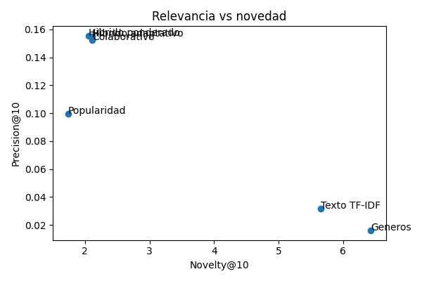

# Recomendador híbrido de películas (MovieLens 1M)

Sistema de recomendación para una plataforma de streaming que busca recomendar películas relevantes y, a la vez, impulsar el descubrimiento de títulos poco populares. Trabajo del curso Aplicaciones de Data Science (UPC, 2026-2).

## Qué hice

1. **Cuatro modelos base:** popularidad, TF-IDF sobre títulos, filtrado colaborativo ítem-ítem (similitud coseno) y contenido por géneros.
2. **Dos híbridos:** uno ponderado con pesos fijos y uno **adaptativo**, cuyos pesos cambian según el tamaño del historial de cada usuario. Los parámetros se eligieron en validación (split 70/15/15 por usuario).
3. **Evaluación en test** con Precision@K, Recall@K, NDCG@K, cobertura del catálogo, diversidad intralista y novedad, para K = 5 y K = 10.
4. **Robustez:** experimentos con menos historial de usuario y con un tope a la cantidad de películas populares por lista.
5. **Decisión de negocio:** matriz de decisión ponderada para elegir un modelo piloto: el híbrido adaptativo con un máximo de 30 % de títulos populares por lista.



## Archivos

- `PC4_Sistema_de_Recomendacion_Hibridos_Solucion.ipynb`: notebook completo con código, resultados y análisis.
- `pregunta1.py` a `pregunta6.py`: el mismo código en scripts para correrlo localmente.
- `p4_*.png`: gráficos de relevancia, cobertura y trade-off.

## Cómo correrlo

```bash
pip install pandas numpy scipy scikit-learn matplotlib
```

Abre el notebook en Jupyter o Google Colab. El dataset MovieLens 1M se descarga automáticamente desde GroupLens.

## Stack

Python · pandas · NumPy · scikit-learn · matplotlib
